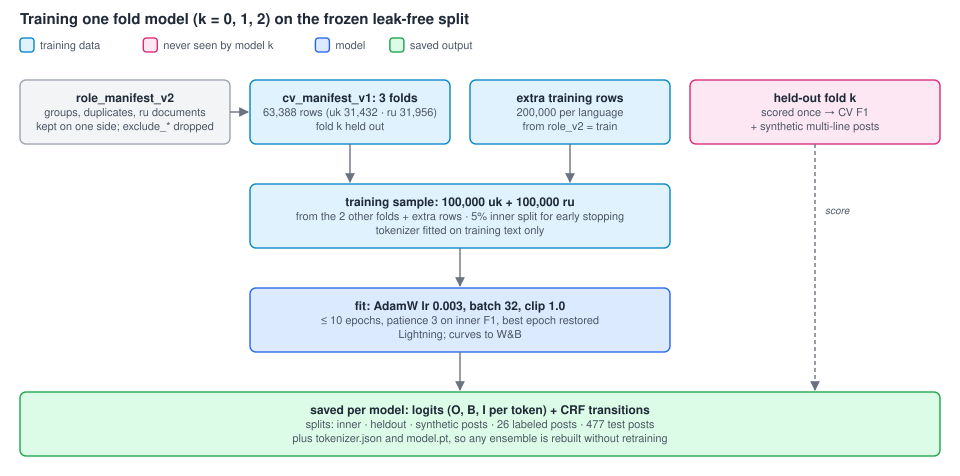
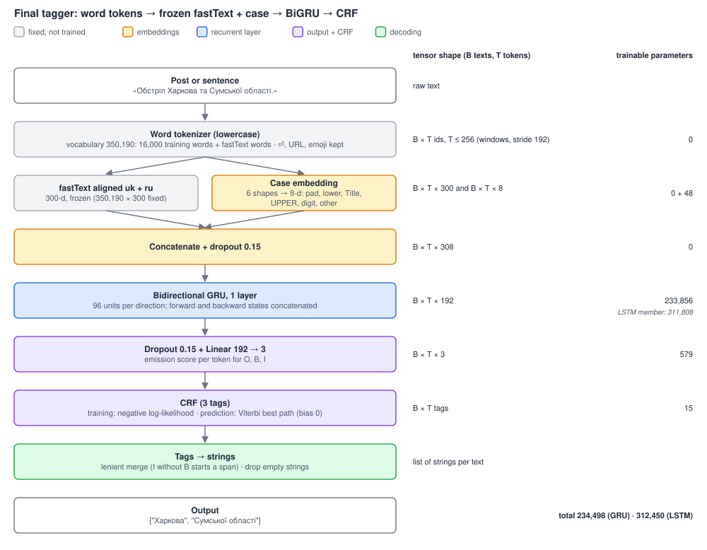
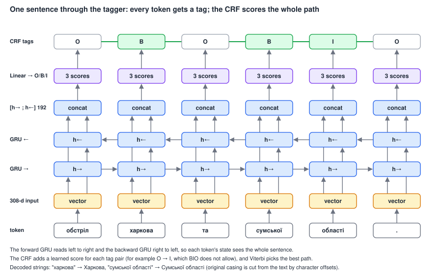
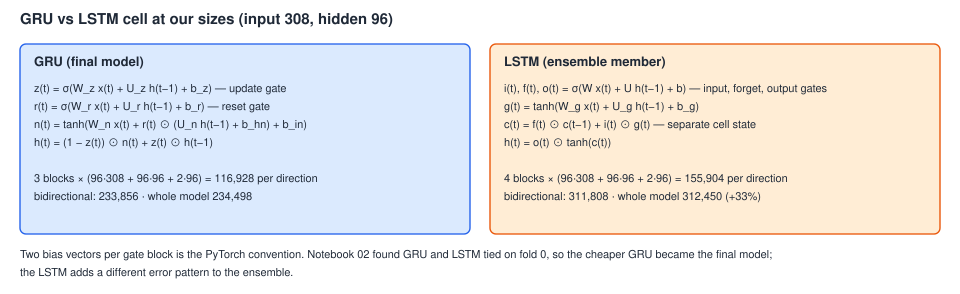

# Finding place names in Ukrainian and Russian posts

This is our report for the Kaggle competition [KSE UA Location Extraction 2026](https://www.kaggle.com/competitions/kse-ua-location-extraction-2026). The task is to read a Telegram post in Ukrainian or Russian and list the places it mentions, such as "Харків" or "Одеська область".

Our best public leaderboard score is **0.59475**. It comes from a small recurrent network: a bidirectional GRU with a CRF layer that reads both the words and their letters. For comparison, the organisers' BERT baseline scores 0.59296 and the best team 0.61237.

The report follows the project in the order we did it:

1. [Look at the data](#step-1-look-at-the-data)
2. [Build the model one decision at a time](#step-2-build-the-model-one-decision-at-a-time)
3. [Train the recipe on all folds and submit](#step-3-train-the-recipe-on-all-folds-and-submit)
4. [Try to beat it](#step-4-try-to-beat-it)
5. [The final model](#step-5-the-final-model)
6. [Why our local score and the leaderboard disagree](#why-our-local-score-and-the-leaderboard-disagree)
7. [About the metric](#about-the-metric)

After that come the steps to reproduce the results, how we used AI, and an appendix with every submission and the data split rules.

## Step 1. Look at the data

Everything in this step is in the [EDA guide](eda/README.md) and its notebooks.

**What we have.**

| Data | Rows | What it is |
| --- | ---: | --- |
| Ukrainian source | 1,010,000 | Labeled text |
| Russian source | 8,028,840 | Labeled sentences with document IDs |
| `test.csv` | 477 | Telegram posts; the labels are hidden, Kaggle scores our predictions |
| `labeling_sample.csv` | 26 | Labeled posts from the competition, used for sanity checks |

The training data are short sentences. The test data are Telegram posts. Much of the project comes back to this difference.

**Labels.** Each row lists its places with character positions. We turned them into one tag per word: B for the first word of a place, I for the next words of the same place, O for everything else. "Одеська/B область/I" is one place. Building the tags from the character positions keeps 99.49% of the places. The ready-made tags in the Ukrainian Parquet file keep only 96.57%, because they lose the border between two names that stand next to each other.

**Repeated texts.** The same sentence often appears many times, sometimes with small changes. If one copy lands in training and another in validation, the model only has to remember it, and the score looks better than it is. We found 251,830 groups of repeated texts (777,785 rows) and kept each group on one side of every split. A Russian sentence also stays with the rest of its document. This cost a lot: about 1.34 million Russian rows were dropped, because chains of shared news snippets link them to the evaluation rows. We accepted the loss to keep the evaluation honest.

**The split.** Every row got one role: `train`, `development`, `final` (locked away for a last check) or one of the `exclude_*` roles ([full table](#required-split-and-exclusion-policy-for-future-experiments)). From `train` and `development` we sampled 63,388 rows and divided them into three folds for cross-validation (CV). Related rows always stay in the same fold.

For fold k, the model trains on the other two folds plus extra `train` rows from outside the CV sample. It picks its best epoch on a small inner split of its own training data and is tested once on fold k. So every CV row is tested exactly once, by a model that never saw it.

**Posts are not like the training sentences.** A post is about 395 characters long on average, a training sentence 102–119. Posts have line breaks, lists, emoji and links. We trained a classifier to tell training sentences from posts (this is called adversarial validation). Even after we matched the lengths and hid links, emoji and line breaks, it still told Ukrainian sentences from posts apart with AUC 0.84, where 0.5 would mean it cannot. So a good score on the training sentences may not carry over to the posts. This warning came true later.

**Unfamiliar names are the hard part.** About 40% of the places in the held-out folds contain a word that the model's vocabulary does not know. The pilot models found 76–87% of the names they had seen in training, but only 24–25% of the Ukrainian names they had never seen.

**First models.** Small word-level BiGRU and BiLSTM pilots without a CRF reached 0.63–0.65 F1 on CV and 0.40–0.41 on the leaderboard. Whole words beat BPE word pieces by 0.08–0.09 in every fold.

**What we carried forward:** use the frozen grouped folds, work with whole words, and watch two weak spots, unfamiliar names and long posts.

## Step 2. Build the model one decision at a time

### How the model works

The model reads a post word by word and gives every word a tag (O, B or I). Each word becomes a list of numbers made of three parts:

- a ready-made fastText word vector (300 numbers), which we keep frozen;
- a small case vector (8 numbers) that says whether the word is lowercase, Capitalised, UPPER or a number, because the word lookup ignores case;
- in the final model only, 64 numbers from a character encoder that reads the letters of the word (step 4).

A bidirectional GRU reads these vectors left to right and right to left, so each word sees the words on both sides. A linear layer turns its output into a score for each tag. The CRF layer then picks the best sequence of tags for the whole sentence, using the Viterbi algorithm. Finally, the words tagged B and I are cut out of the original text as place names.

### The decisions

Notebooks 01–05 each answer one question. We changed one thing, kept everything else fixed, compared the variants on the CV folds and kept the winner. These variants did not go to Kaggle: there were too many of them, and Kaggle allows 10 submissions a day.

**[01](model/01_tokenization_embeddings.ipynb). Words or word pieces? Which word vectors?** Whole words beat BPE again. The best word vectors were the ready-made fastText vectors that put Ukrainian and Russian words into one shared space (called "aligned" vectors). We keep them frozen, so the model does not change them. We also tried the character encoder here. In a short run it scored 0.813 against 0.832 without it, so we left it out. We came back to it in step 4.

**[02](model/02_architecture.ipynb). Which network?** GRU and LSTM scored the same, so we took the smaller GRU. One layer with 96 units in each direction was enough; bigger networks did not help. The CRF layer added 0.023 F1 on all three folds. It learns which tag orders make sense (for example, I cannot follow O).

**[03](model/03_training_setup.ipynb). How to train?** We tried other optimizers, learning rates, schedules, batch sizes and dropout. Nothing beat the starting setup by more than the noise between random seeds (0.013). We kept AdamW with learning rate 0.003 and batch size 32.

**[04](model/04_data_strategy.ipynb). How much data?** Going from 10,000 to 100,000 sentences per language raised F1 from 0.856 to 0.885, and the curve was still rising. The mix of Ukrainian and Russian made no real difference. Special tokens for line breaks, links and emoji added 0.017 on synthetic posts (several held-out sentences joined into one text). We took 100,000 sentences per language and the special tokens.

**[05](model/05_decoding_logits_ensembling.ipynb). How to decode and combine models?** We tuned the small rules that turn tags into strings. Averaging three models trained with different seeds gave 0.893 against 0.883 for one model. The best way to combine models is to average their tag scores and CRF transitions, then decode once. Adding an LSTM as a fourth member raised fold 0 to 0.898.

Every setting of the recipe sits next to its evidence in [`model/nerkit/decisions.py`](model/nerkit/decisions.py). Gradient flow is logged per layer in every run and plotted in notebooks 02 and 03.

## Step 3. Train the recipe on all folds and submit

**[06](model/06_final_cv_training.ipynb). One model per fold.** The recipe scored 0.885, 0.896 and 0.894 on the three folds, 0.891 on average. Each fold model also saved its raw scores for the test posts, so later we could combine models without training them again.

**[07](model/07_combine_folds.ipynb). Combine the three fold models.** We tried two ways:

- **vote**: keep a place if at least 2 of the 3 models predict it, leaderboard **0.58914**;
- **average**: average the scores of the three models and decode once, leaderboard 0.58787.

The best single fold model scored 0.58594, so combining helped a little. We have no CV score for these combinations, because each fold was in the training data of two of the three models.

**[08](model/08_split_inference.ipynb). Split long posts before tagging.** Cutting posts into sentences or lines made the score worse (0.57488 and 0.57228), so we kept whole posts.

At this point we had 0.891 on CV and 0.589 on the leaderboard: a gap of 0.30.

## Step 4. Try to beat it

We had four ideas. Each one came from an earlier finding.

**[09](model/09_gru_lstm_ensemble.ipynb). Add an LSTM to every fold** (from notebook 05). We trained an LSTM on each fold with the same recipe. The fold-0 LSTM scored 0.899, the same as in notebook 05 on another computer, so the recipe reproduces. The GRU and the LSTM of fold k both trained without fold k, so this time the pair has an honest CV score. On CV the LSTM scored 0.902 and the GRU + LSTM pair 0.904, the best so far. On the leaderboard all three combinations lost to the GRU alone: LSTM 0.56304, GRU + LSTM average 0.57698, vote 0.57311. This was the first clear sign that CV and the leaderboard disagree.

**[10](model/10_more_data.ipynb). Three times more data** (from notebook 04). We used 300,000 sentences per language instead of 100,000 and changed nothing else. This was too slow for a laptop, so we ran it on a Colab GPU (L4). One epoch took about 28 minutes, so near the deadline we stopped training by hand after 3–6 epochs and kept the best epoch of each fold. CV rose to 0.899, and the synthetic posts to 0.882 from 0.873. The leaderboard fell: 0.58170 for the vote, 0.57313 for the average.

**[11](model/11_char_encoder.ipynb). Read the letters of each word** (from the unfamiliar names in step 1). A frozen word vector cannot help with a name the vectors do not know. The character encoder is a small BiGRU that reads each word letter by letter and adds 64 numbers to the word's vector. It can learn that "Новоолександрівка" ends like many other villages, or that a capital letter starts a name. It trains together with the rest of the model and adds 59,200 parameters. On CV it scored 0.896 against 0.891. It found 66.2% of the unfamiliar Ukrainian names against 63.4%, exactly the weak spot it was meant to fix. On the leaderboard it scored **0.59475** (average) and 0.59467 (vote), our best result.

**[12](model/12_char_more_data_ensemble.ipynb). Combine the models of 10 and 11.** This needed no new training. The six models scored 0.904 on CV and 0.720 on the 26 labeled posts, the best of all our models on both. On the leaderboard they scored 0.58753 (average) and 0.58857 (vote 3 of 6), below the character models alone.

| Idea | CV F1 | Leaderboard | Kept? |
| --- | ---: | ---: | --- |
| Starting point: GRU, vote of 3 folds (07) | 0.891 | 0.58914 | |
| Add an LSTM (09) | 0.904 | 0.57698 | No |
| Three times more data (10) | 0.899 | 0.58170 | No |
| Character encoder (11) | 0.896 | **0.59475** | **Yes** |
| Character + more-data models (12) | 0.904 | 0.58857 | No |

## Step 5. The final model

The final submission averages the three fold models of the word + character BiGRU-CRF from notebook 11.

| | Word BiGRU-CRF | + character encoder (final) | Word BiLSTM-CRF |
| --- | ---: | ---: | ---: |
| Trainable parameters | 234,498 | 293,698 | 312,450 |
| Words with frozen vectors | 350,190 | 350,190 | 350,190 |

Training settings: 100,000 Ukrainian and 100,000 Russian sentences, AdamW with learning rate 0.003 and weight decay 0.01, batch size 32, gradient clipping 1.0, dropout 0.15. Training runs for at most 10 epochs and stops early after 3 epochs without improvement on the inner split; the best epoch is restored. The random seed is 3012026. The training loop uses PyTorch Lightning ([`model/nerkit/engine.py`](model/nerkit/engine.py)), with optional Weights & Biases logging (project `ai301-ner-final`).

For Kaggle's final ranking we suggest two submissions from different model families: the character model average (0.59475) and the GRU vote of notebook 07 (0.58914).

## Why our local score and the leaderboard disagree

| Model (three fold models) | CV F1 | Unfamiliar Ukrainian names found | 26 labeled posts F1 | Leaderboard |
| --- | ---: | ---: | ---: | ---: |
| Word BiGRU-CRF | 0.891 | 0.634 | 0.694 | 0.588 |
| Word BiLSTM-CRF | 0.902 | 0.654 | 0.639 | 0.563 |
| GRU + LSTM | 0.904 | — | 0.649 | 0.577 |
| Word + character BiGRU-CRF | 0.896 | 0.662 | 0.684 | 0.595 |
| Word BiGRU-CRF, 300k rows | 0.899 | 0.605* | 0.676 | 0.573 |
| Character + 300k models | 0.904 | — | 0.720 | 0.588 |

\*Not comparable: with three times more data, fewer names are unfamiliar, and the ones left are harder. CV and the unfamiliar-name share are averages over the fold models. The labeled-post and leaderboard scores belong to the submitted combination.

**Two things stand out.** First, the gap: about 0.89 on CV against 0.59 on the leaderboard. Second, CV does not put the models in the right order. The LSTM is second on CV and last on the leaderboard. More data and the six-model ensemble also won on CV and lost on Kaggle. The only change that helped on the leaderboard, the character encoder, was not the best on CV. Even the 26 labeled posts picked the wrong winner once (notebook 12): 26 posts are too few to choose a model with.

**Why.** CV tests the model on the same kind of text it trained on: short sentences. The leaderboard tests it on Telegram posts, and step 1 already showed that a classifier tells the two apart. Posts are longer and contain lists ("Чорнобиль - 19 / Тетерів - 9"), footers and many rare street and village names. When we checked our errors on the 26 labeled posts, we found missed list items, borders in the wrong place at a sentence end ("проспекті Івасюка. Так"), and real places that the labels leave out. A change that makes the model better at the training sentences can make it a little worse at posts. The character encoder is different, because it targets unfamiliar names, which are common in posts.

**Is the model good enough?** For single sentences like the training data, yes: 0.89–0.90 F1, with precision 0.91 and recall 0.87, and stable across folds. For Telegram posts it is limited: 0.59, about the level of the organisers' BERT baseline and 0.02 below the best team. Our CV is a good tool to compare small changes inside one model family, but it cannot predict the leaderboard or compare different families. The most useful next step would be a validation set of labeled posts, much larger than 26 (a plan is in [`eda/competition_like_validation_plan.md`](eda/competition_like_validation_plan.md)).

## About the metric

Kaggle compares, for every post, the set of places we predict with the set of true places. Before comparing, it cleans each string: it removes punctuation, digits and one-letter words and lowercases the rest. Matches, extra places and missed places are counted over all posts together, and F1 is computed from those totals (micro F1). Our local copy is [`competition_f1`](eda/core/analysis.py).

**What is good about it.** It scores what a user actually needs, the list of places, not the tags. So any model or decoding rule can be compared with it. The cleaning forgives harmless differences, such as "м. Київ" against "Київ". Repeating a place in one post does not matter.

**What is not so good.**

- A border mistake costs twice. Predicting "вулиці Гоголівська" when the label is "Гоголівська" counts as one extra and one missed place, with no credit for the shared word.
- Different grammatical forms count as different places: "Києві" is not "Київ". The score depends on which form the annotator copied.
- Long posts weigh more. One post that lists ten towns counts as much as ten ordinary posts.
- Missing labels count real places as mistakes. In the 26 labeled posts, "Київ", "Боярка" and "Васильків" are predicted but not labeled in some posts.

**What could be better.** A partial-match F1 would give credit for overlapping words (for example, word-level Jaccard similarity). Reducing words to their base form on both sides would merge "Києві" and "Київ". Averaging F1 per post would stop long posts from dominating. We still chose models by the competition metric, because that is what the leaderboard ranks.

## How to reproduce

1. Put the competition CSV files into `data/kse-ua-location-extraction-2026/` and download the split files with `git lfs pull` ([dataset guide](data/kse-ua-location-extraction-2026/README.md#team-setup-and-experiment-splits)).
2. Install `model/requirements.txt` (Python 3.11) and run the notebooks in `model/` in order. Notebook 00 builds the data cache and picks the device. Every run is named by its settings, so a finished run is skipped on a rerun. Its results are in `model/results/<notebook>.jsonl`.
3. Notebook 10 runs on Colab. Upload `ner_bundle.zip` (code, test files and data cache) to `MyDrive/ai301_more_data/` and run all cells on a GPU.

## Appendix

### All submissions

| Submission | Notebook | CV F1 | Leaderboard F1 |
| --- | --- | ---: | ---: |
| Word + character BiGRU-CRF, average of 3 folds | [11](model/11_char_encoder.ipynb) | 0.896 | **0.59475** |
| Word + character BiGRU-CRF, vote 2 of 3 | [11](model/11_char_encoder.ipynb) | 0.896 | 0.59467 |
| Word BiGRU-CRF, vote 2 of 3 | [07](model/07_combine_folds.ipynb) | 0.891 | 0.58914 |
| Character + 300k models, vote 3 of 6 | [12](model/12_char_more_data_ensemble.ipynb) | — | 0.58857 |
| Word BiGRU-CRF, average of 3 | [07](model/07_combine_folds.ipynb) | 0.891 | 0.58787 |
| Character + 300k models, average of 6 | [12](model/12_char_more_data_ensemble.ipynb) | 0.904 | 0.58753 |
| Word BiGRU-CRF, single fold 2 / 1 / 0 | [06](model/06_final_cv_training.ipynb) | 0.894 / 0.896 / 0.885 | 0.58594 / 0.58308 / 0.57098 |
| Word BiGRU-CRF, 300k rows per language, vote 2 of 3 | [10](model/10_more_data.ipynb) | 0.899 | 0.58170 |
| GRU + LSTM, average of 6 | [09](model/09_gru_lstm_ensemble.ipynb) | 0.904 | 0.57698 |
| Posts split into sentences / lines before tagging | [08](model/08_split_inference.ipynb) | — | 0.57488 / 0.57228 |
| Word BiGRU-CRF, 300k rows per language, average of 3 | [10](model/10_more_data.ipynb) | 0.899 | 0.57313 |
| GRU + LSTM, vote 3 of 6 | [09](model/09_gru_lstm_ensemble.ipynb) | — | 0.57311 |
| BiLSTM-CRF, average of 3 | [09](model/09_gru_lstm_ensemble.ipynb) | 0.902 | 0.56304 |
| Word BiLSTM pilot, vote (EDA, no CRF) | [EDA](eda/README.md#kaggle-submission-results) | 0.646 | 0.41086 |
| Word BiGRU pilot (EDA, no CRF) | [EDA](eda/README.md#kaggle-submission-results) | 0.628 | 0.40449 |

CV is the average over the three held-out folds. For a combination of fold models, each fold is scored only by the models that did not train on it. "—" means there is no such honest score: a vote needs all three fold models, and each fold was in the training data of two of them.

### Required split and exclusion policy for future experiments

**Every experiment uses the frozen split.** Use `eda/output/role_manifest_v2.parquet` and its `role_v2` column, not a new random split of the raw CSVs. Join it to the source rows by `(source, row_id)`. The split files are shared through Git LFS; the [dataset guide](data/kse-ua-location-extraction-2026/README.md#team-setup-and-experiment-splits) explains how to download and join them.

| `role_v2` | Ukrainian rows | Russian rows | Meaning and permitted use |
| --- | ---: | ---: | --- |
| `train` | 959,912 | 6,415,583 | Pool for training and tokenizer fitting; experiments may use smaller samples. |
| `development` | 39,912 | 119,789 | Model selection in fixed-split experiments. Enters training only through grouped CV or an approved final refit. |
| `final` | 10,000 | 32,014 | Reserved evaluation. Use only after the recipe is frozen and evaluation is approved; never for training or model selection. |
| `exclude_conflict` | 0 | 22,562 | The same text appears with different location labels. Excluded rather than guessing the right label. |
| `exclude_duplicate` | 48 | 98,608 | Training row whose exact text also appears in development or final. |
| `exclude_final_duplicate` | 4 | 0 | Ukrainian development row whose exact text also appears in final. |
| `exclude_development_group` | 97 | 15,169 | Training row linked to a development group. |
| `exclude_final_group` | 27 | 1,325,115 | Training or development row linked to a group that contains final rows. |

Each row has exactly one role, so the exclusion counts do not overlap. **Never use an `exclude_*` row for training, tokenizer fitting or evaluation.** The raw files still contain these rows; that does not make them usable.

### Repository guide

| Path | Contents |
| --- | --- |
| [`eda/README.md`](eda/README.md) | Step 1: data audit, split construction, adversarial validation, pilot models |
| [`model/`](model/) | Steps 2–5: notebooks 00–12 (executed), the `nerkit` package, result records in `model/results/` |
| [`model/nerkit/decisions.py`](model/nerkit/decisions.py) | The final recipe and the evidence for each setting |
| [`docs/figures/`](docs/figures/) | Report figures; rebuild them with `python scripts/make_report_figures.py` |
| [`eda/competition_like_validation_plan.md`](eda/competition_like_validation_plan.md) | Plan for a validation set of labeled posts |
| [`data/kse-ua-location-extraction-2026/README.md`](data/kse-ua-location-extraction-2026/README.md) | Dataset description and team setup |

Raw data, model weights, saved scores and submission files stay outside Git. Only the split files are shared, through Git LFS.
